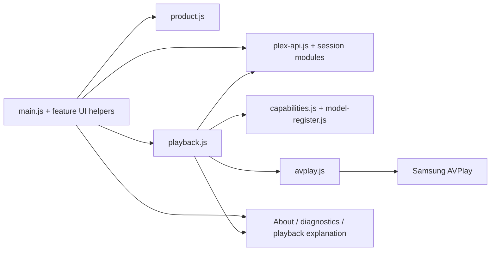

# Vemm architecture and implementation plan

## Direction

Vemm remains a Samsung-first ES5 Web application. The transition improves real
boundaries already present in the code; it does not create empty cross-platform
directories, move every feature, introduce a framework, or implement another
platform.

## KEEP / CUT / DEFER

### KEEP

- Existing DOM/CSS presentation, focus/Back ownership, lifecycle and bounded
  resource handling.
- `plex-api.js` transport and Plex protocol boundaries.
- `playback.js` as the policy/session seam and `avplay.js` as the Samsung
  backend seam.
- Capability evidence split between published specifications and exact observed
  tuples.
- Optional WebGL backend off by default with the current fallback.
- Clean Vemm package/application IDs, storage keys, future author continuity,
  release filenames, GPL provenance and complete-source distribution.

### CUT

- Repeated current display-name literals across runtime, manifest, protocol
  headers and current documentation.
- The raster-only brand source.
- Diagnostics that expose only a final playback mode without the policy reason,
  fallback and evidence class.
- Temporary-label language that implies the product still lacks a working
  source identity.

### DEFER

- A universal media-player framework or abstract platform directory tree.
- LG, Windows, macOS or other platform implementations.
- Broad `main.js` decomposition without a separately proven ownership boundary.
- New graphics engines, AI upscaling, frame interpolation or default-on WebGL.
- Repository rename/fork detachment, Store distribution, signing changes,
  device deployment and release publication.
- Device support expansion beyond named evidence.

## Implemented seams

### Product identity

`js/product.js` is a read-only runtime contract for name, pronunciation,
tagline, platform and working-brand status. HTML retains correct static
fallbacks, while `main.js` consumes the contract for the live title, header and
About screen. Plex product headers use the same current name.

This is intentionally not a configuration framework. The build/install seams
own the separate Vemm identity; Plex service clients retain protocol naming.

### Explainable playback policy

`playback.js` continues to own selection and session negotiation. Its plan now
adds a structured explanation:

- selected mode: Direct Play, Direct Stream or transcode;
- machine reason code;
- fallback policy;
- capability evidence status, measured flag and source.

The explanation changes when PMS or AVPlay refuses the original. Stats for
nerds surfaces the bounded, non-sensitive explanation. Tokens, origins, titles
and raw native errors remain excluded.

## Sequenced plan and acceptance

1. **Audit:** bind the current tree, release history, architecture, evidence and
   holds in `01-current-state-audit.md`.
2. **Identity:** add original vector assets, deterministic raster generation,
   product identity contract, About presentation and current-source branding.
3. **Policy seam:** make playback decisions explainable without changing
   capability rules or AVPlay behavior.
4. **Regression:** pin branding, asset freshness, Vemm IDs/settings,
   staged package contents and playback explanations.
5. **Documentation:** reconcile root/product/build/install/release/provenance
   language and record remote migration separately.
6. **Validation:** focused tests, full host gate, toolkit validate/build where
   available, package/source inventory, then a frozen-tree independent review.
7. **Integration:** commit, push and open a PR; require exact-candidate CI. Do
   not merge, sign, deploy or publish.

Acceptance requires strict ES5, clean Vemm installed identity and settings,
fresh deterministic assets, existing negotiation tests plus explanation tests,
clean staged contents, coherent local links and explicit skipped device/release
gates.
