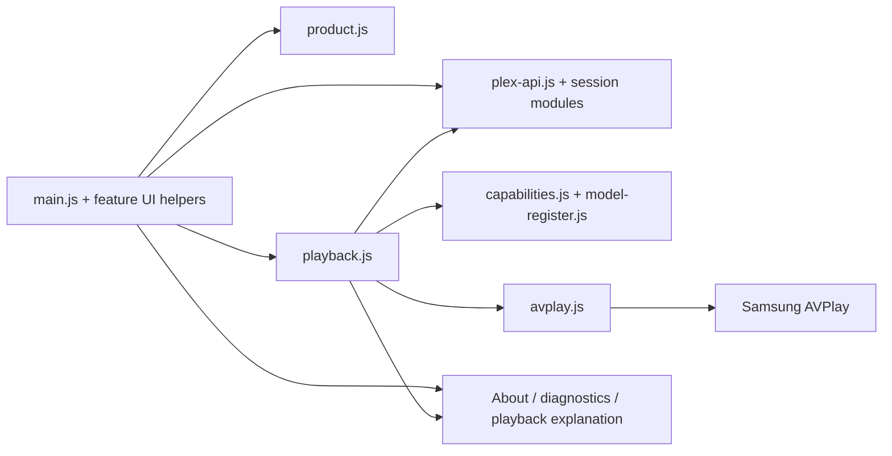

# Vemm architecture and implementation plan

## Direction

Vemm remains a Samsung-first ES5 Web application. The transition improves real
boundaries already present in the code; it does not create empty cross-platform
directories, move every feature, introduce a framework, or implement another
platform.

## KEEP / CUT / DEFER

### KEEP

- Existing DOM/CSS presentation, focus/Back ownership, lifecycle and bounded
  resource handling.
- `plex-api.js` transport and Plex protocol boundaries.
- `playback.js` as the policy/session seam and `avplay.js` as the Samsung
  backend seam.
- Capability evidence split between published specifications and exact observed
  tuples.
- Optional WebGL backend explicitly labelled experimental, with no demonstrated
  performance benefit, off by default with the current fallback. It is not an
  upgrade to the existing Home compositor acceleration or AVPlay.
- Clean Vemm package/application IDs, storage keys, future author continuity,
  release filenames, GPL provenance and complete-source distribution.

### CUT

- Repeated current display-name literals across runtime, manifest, protocol
  headers and current documentation.
- The raster-only brand source.
- Diagnostics that expose only a final playback mode without the policy reason,
  fallback and evidence class.
- Temporary-label language that implies the product still lacks a working
  source identity.

### DEFER

- A universal media-player framework or abstract platform directory tree.
- LG, Windows, macOS or other platform implementations.
- Broad `main.js` decomposition without a separately proven ownership boundary.
- New graphics engines, AI upscaling, frame interpolation or default-on WebGL.
- Repository rename/fork detachment, Store distribution, signing-identity
  changes and release publication.
- Device support expansion beyond named evidence.

## Implemented seams

### Product identity

`js/product.js` is a read-only runtime contract for name, pronunciation,
tagline, platform and working-brand status. HTML retains correct static
fallbacks, while `main.js` consumes the contract for the live title, header and
About screen. Plex product headers use the same current name.

This is intentionally not a configuration framework. The build/install seams
own the separate Vemm identity; Plex service clients retain protocol naming.

### Explainable playback policy

`playback.js` continues to own selection and session negotiation. Its plan now
adds a structured explanation:

- selected mode: Direct Play, Direct Stream or transcode;
- machine reason code;
- fallback policy;
- capability evidence status, measured flag and source.

The explanation changes when PMS or AVPlay refuses the original. Stats for
nerds surfaces the bounded, non-sensitive explanation. Tokens, origins, titles
and raw native errors remain excluded.

### Scoped Home outage recovery

The current client can retain one in-memory Home snapshot: at most 100 library
descriptors, 20 shelves, 12 preview cards per shelf and 200 cards overall.
Only explicit display/identity fields are copied; snapshots larger than
256 Ki UTF-16 code units are discarded. The snapshot expires after five
minutes and is tied to the exact PMS client and active profile identity.
It is never written to app storage.

A transient network/5xx failure may display explicitly labelled cached Home
with Retry. Cancellation, authorization refusal, changed client/profile,
profile-selection/PIN entry, sign-out and expired grants do not authorize a
cached fallback. Cached cards are not offline media: playback, mutations,
detail reads and grant checks still need their normal reachable endpoints.
No offline write queue, saved grant extension or media download is added.

### Profile and server navigation boundaries

Entering profile selection or server discovery retires the previous browsing
client, retained pages, Home snapshot, filters and navigation closures. A PIN
screen's remote Back returns to profile selection, never to a prior profile's
Home or library. Late page/profile responses still require their original view
generation. The selected profile's token owns subsequent server discovery;
only the linked account token is persisted for restart, not a managed-profile
unlock. Returning from Settings to the same profiles/server screen may retain
that screen's focus and scroll, but cannot retain media-view navigation.

Library return closures snapshot their own retained items, offset, filters and
photo total after each accepted page. They never read another library's later
global page state. The existing 200-item live window and 20-entry navigation
limit remain; Back restores the owning snapshot, while accepted watched-state
changes refresh the page containing the opening item instead of stale badges.

### Watchlist mutation read-back

Both catalogue and local-detail Watchlist actions use the account client's
single explicit PUT followed by independent `all`-Watchlist reads with that
same identity's token. Addition requires observing the exact catalogue GUID;
removal requires observing absence through the complete bounded result.
Read-back retains one 50-row page at a time and stops at 200 examined rows.
If a larger result is needed to establish membership, or a page is malformed,
unchanged, denied or incomplete, the outcome is explicitly unconfirmed; it is
not a failed-write claim or permission to replay the PUT. Browse paging itself
is not limited by this verification bound. Leaving the originating request
scope prevents a late write response from starting new read-back requests.
Synthetic membership fixtures do not establish actual cloud persistence or an
atomic snapshot across concurrent external Watchlist edits.

### Optional Home layouts

`js/home-layout.js` validates TV-local layout records; `main.js` uses the existing
Account menu, value rows, selection indicators, D-pad and Back ownership.
Customization is never an onboarding requirement. Server shelf order, visibility
and the existing manual featured-title controls are unchanged without a saved
layout. Hiding a shelf also excludes its preview items from the hero pool.

Persistence requires both the selected server machine identifier and the active
Plex profile UUID/ID. A manually entered server without verified identities
can still browse but cannot save a layout. These records grant no access and
are only applied to metadata already returned through the current client's
normal authentication, PIN/profile and favourite-library boundaries.
The separate `vemm-tizen-home-layouts` record stores only server/profile IDs,
the hero boolean and ordered/hidden shelf IDs, never tokens, origins, titles,
artwork or media IDs. It holds at most 20 scopes, evicting the oldest saved
scope, and at most 100 unique shelf choices per scope. Reads reject malformed,
extra-field, duplicate-scope and oversized (over 1 Mi UTF-16 code units) records.

A shelf identity combines its numeric library section, when supplied, with its
validated server hub identifier. Saved surviving shelves keep their order;
new shelves follow in server order; missing shelves are ignored and dropped on
the next save. Missing/unsafe/duplicate identifiers are not replaced with
translated labels or array positions: those shelves remain visible and are
not editable. Shelves beyond the 100-choice customization bound stay visible.
An intentionally all-hidden Home still exposes Account and recovery copy.

Edits are a draft until Save Home succeeds. Remote Back discards them and returns
to the opening Account control; a failed save preserves the draft and Retry
repeats that save. Reset this Home removes only the selected scope. Invalid or
unreadable saved data produces an explicit error rather than silently appearing
saved; Retry reads it again and Reset all Home layouts removes only this layout
record, with reset failures remaining visible. Settings' existing Reset
preferences also removes layouts. Home-only resets leave interface text,
reduced motion, converted audio volume and other playback preferences intact.
Synthetic helper and actual-main.js remote journeys cover these contracts;
named-TV layout, held keys, restart/PIN switching and standby remain acceptance
gaps for the exclusive device owner.

## Historical identity-transition plan and acceptance

The sequence below describes the earlier identity-only transition, not the
current product-backlog authorization. `SPEC.md` now governs the complete
0.2.0 implementation and specifically authorized existing-author TV updates;
Store submission, signing-identity changes and public releases remain outside
that deployment grant.

1. **Audit:** bind the current tree, release history, architecture, evidence and
   holds in `01-current-state-audit.md`.
2. **Identity:** add original vector assets, deterministic raster generation,
   product identity contract, About presentation and current-source branding.
3. **Policy seam:** make playback decisions explainable without changing
   capability rules or AVPlay behavior.
4. **Regression:** pin branding, asset freshness, Vemm IDs/settings,
   staged package contents and playback explanations.
5. **Documentation:** reconcile root/product/build/install/release/provenance
   language and record remote migration separately.
6. **Validation:** focused tests, full host gate, toolkit validate/build where
   available, package/source inventory, then a frozen-tree independent review.
7. **Integration:** commit, push and open a PR; require exact-candidate CI. Do
   not merge, sign, deploy or publish.

Acceptance requires strict ES5, clean Vemm installed identity and settings,
fresh deterministic assets, existing negotiation tests plus explanation tests,
clean staged contents, coherent local links and explicit skipped device/release
gates.
