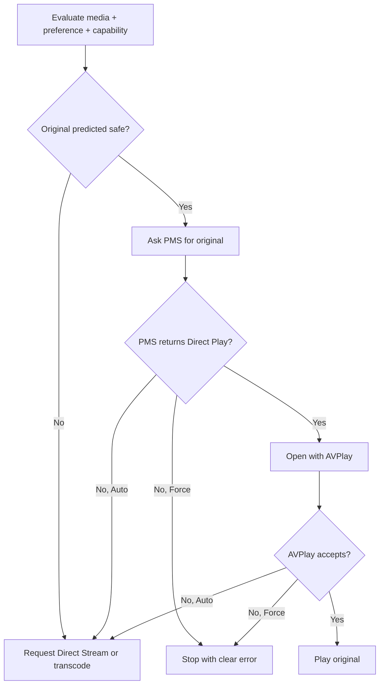

# Vemm playback policy

## Priority

1. Reliable and correct playback.
2. Original-quality Direct Play when supported by evidence and accepted by PMS
   and AVPlay.
3. Direct Stream when the video can be copied and only container/audio changes
   are needed.
4. Server transcode for unsupported codec, resolution, bitrate, bit depth,
   frame rate, HDR, subtitle burn-in, multipart join or user quality limit.
5. Clear failure when Force Direct Play forbids the required conversion.

Original quality is not an instruction to ignore subtitle, audio, container or
decoder constraints.

## Opt-in adaptive quality

Adaptive quality defaults off, independently of Direct Play Auto. When enabled,
known local connections begin at the selected quality ceiling; known remote
connections begin no higher than 1080p/8 Mbps. Unknown connections are not
mislabelled local or remote. Force Direct Play disables adaptation, and choosing
a quality explicitly in the playing-item menu fixes that session's quality.
The saved ceiling is never silently rewritten by adaptation.

For conversion, Vemm advertises ABR with the documented `autoAdjustQuality=1`
and passes `location=lan/wan` only when discovery supplied that classification.
The direct-file request omits the ABR flag. AVPlay's handling of the actual HLS
representations still needs named-model acceptance.

The independent rebuffer policy excludes the first 30 seconds of each pipeline,
ignores stalls shorter than 1.5 seconds, and reduces one rung after an 8-second
stall or two stalls within 60 seconds. Changes are at least 60 seconds apart,
never move up automatically and stop at the 480p floor. Restart uses the same
item/version, playhead, explicit tracks, text cues and subtitle identity.
Paused/background/menu interaction cannot trigger an adaptive restart.
These thresholds are conservative implementation limits, not measured per-TV
performance budgets. Synthetic controller and real-UI/fake-adapter tests cover
the limits, cancellation and no-unintended-autoplay behavior.

## Converted audio volume

Settings offers 50%, 100%, 150% and 200% for server-converted audio.
The bundled PMS OpenAPI defines `audioBoost` as percent of original loudness,
not decibels. The unchanged default, 100%, omits the option. Direct Play's
decision and original-file URL omit it; a server-conversion fallback retains
the explicitly selected percentage. This does not force conversion merely to
change volume. Higher percentages can distort; this is neither dialog
isolation, loudness normalization nor AV sync adjustment.

No local PCM/gain hook has been established for AVPlay. Samsung's deprecated
sound-analysis listener provides spectrum analysis, not audio processing.
`setSubtitlePosition` is external-subtitle timing in milliseconds, not audio
delay or vertical placement. It is not wired to Vemm's DOM text overlay.
Server support and audible output still require disposable-backend and
named-model acceptance; the request option alone does not establish them.

## Inputs

`js/playback.js` evaluates:

- selected media version and Part/Stream facts;
- selected audio and subtitle streams;
- app-rendered versus burned subtitle mode;
- multipart media;
- quality rung and Direct Play preference;
- capability profile from `js/capabilities.js`;
- PMS decision response;
- AVPlay open/prepare result.

A file lacking playable Part stream facts fails before PMS or AVPlay calls.

## Explainable result

Every plan records:

| Field | Meaning |
|---|---|
| `selected` | predicted/current `direct`, `directstream` or `transcode` |
| `reason` | stable machine reason such as `supported`, `audio-codec`, `quality`, `subtitle`, `server` or `decoder` |
| `fallback` | server transcode on refusal, stop on refusal, or no additional fallback |
| `capability.status` | `observed`, `documented` or `unknown` |
| `capability.measured` | whether the profile matched an exact registered TV tuple |
| `capability.source` | source document/register reference, not private device data |

The explanation is diagnostic output, not a new negotiation input. Existing PMS
queries, fallback behavior and AVPlay lifecycle remain authoritative.

## Fallback behavior

Decoder refusal is stronger evidence for the current attempt than the profile
prediction, but it is not automatically persisted as a universal model rule.

## Diagnostics and privacy

Stats for nerds may show mode, reason, fallback and evidence class. It must not
show account/server tokens, private origins, titles in routine logs, DUIDs,
certificate paths or raw native exception strings.

Host tests prove decision contracts and fallback state transitions. They do not
prove decoder output, HDR, audio, subtitle composition, panel quality or server
hardware transcoding.
