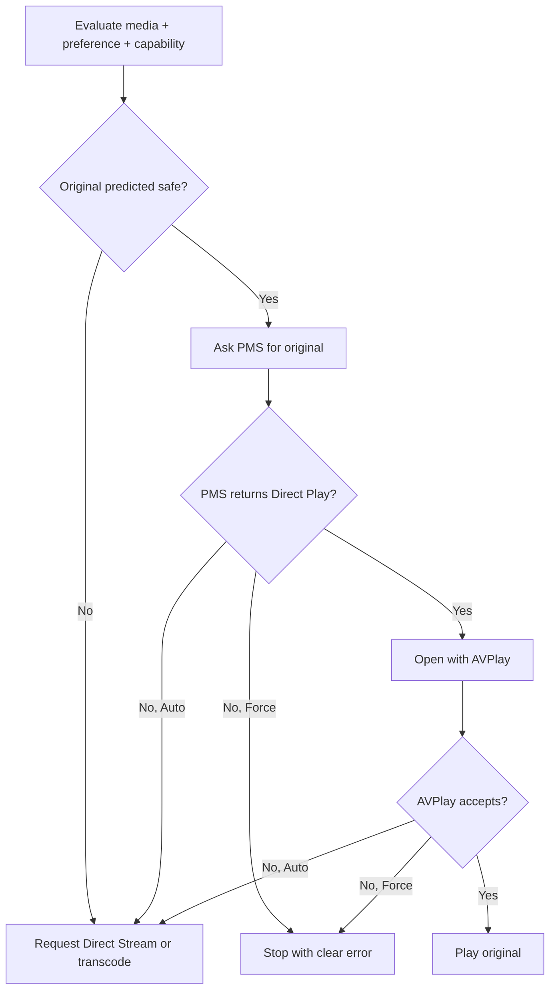

# Vemm playback policy

## Priority

1. Reliable and correct playback.
2. Original-quality Direct Play when supported by evidence and accepted by PMS
   and AVPlay.
3. Direct Stream when the video can be copied and only container/audio changes
   are needed.
4. Server transcode for unsupported codec, resolution, bitrate, bit depth,
   frame rate, HDR, subtitle burn-in, multipart join or user quality limit.
5. Clear failure when Force Direct Play forbids the required conversion.

Original quality is not an instruction to ignore subtitle, audio, container or
decoder constraints.

## Inputs

`js/playback.js` evaluates:

- selected media version and Part/Stream facts;
- selected audio and subtitle streams;
- app-rendered versus burned subtitle mode;
- multipart media;
- quality rung and Direct Play preference;
- capability profile from `js/capabilities.js`;
- PMS decision response;
- AVPlay open/prepare result.

A file lacking playable Part stream facts fails before PMS or AVPlay calls.

## Explainable result

Every plan records:

| Field | Meaning |
|---|---|
| `selected` | predicted/current `direct`, `directstream` or `transcode` |
| `reason` | stable machine reason such as `supported`, `audio-codec`, `quality`, `subtitle`, `server` or `decoder` |
| `fallback` | server transcode on refusal, stop on refusal, or no additional fallback |
| `capability.status` | `observed`, `documented` or `unknown` |
| `capability.measured` | whether the profile matched an exact registered TV tuple |
| `capability.source` | source document/register reference, not private device data |

The explanation is diagnostic output, not a new negotiation input. Existing PMS
queries, fallback behavior and AVPlay lifecycle remain authoritative.

## Fallback behavior

Decoder refusal is stronger evidence for the current attempt than the profile
prediction, but it is not automatically persisted as a universal model rule.

## Diagnostics and privacy

Stats for nerds may show mode, reason, fallback and evidence class. It must not
show account/server tokens, private origins, titles in routine logs, DUIDs,
certificate paths or raw native exception strings.

Host tests prove decision contracts and fallback state transitions. They do not
prove decoder output, HDR, audio, subtitle composition, panel quality or server
hardware transcoding.
