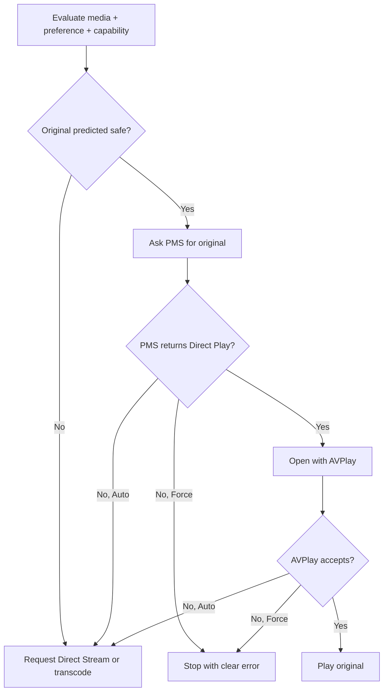

# Vemm playback policy

## Priority

1. Reliable and correct playback.
2. Original-quality Direct Play when supported by evidence and accepted by PMS
   and AVPlay.
3. Direct Stream when the video can be copied and only container/audio changes
   are needed.
4. Server transcode for unsupported codec, resolution, bitrate, bit depth,
   frame rate, HDR, subtitle burn-in, multipart join or user quality limit.
5. Clear failure when Force Direct Play forbids the required conversion.

Original quality is not an instruction to ignore subtitle, audio, container or
decoder constraints.

## Opt-in adaptive quality

Adaptive quality defaults off, independently of Direct Play Auto. When enabled,
known local connections begin at the selected quality ceiling; known remote
connections begin no higher than 1080p/8 Mbps. Unknown connections are not
mislabelled local or remote. Force Direct Play disables adaptation, and choosing
a quality explicitly in the playing-item menu fixes that session's quality.
The saved ceiling is never silently rewritten by adaptation.

For conversion, Vemm advertises ABR with the documented `autoAdjustQuality=1`
and passes `location=lan/wan` only when discovery supplied that classification.
The direct-file request omits the ABR flag. AVPlay's handling of the actual HLS
representations still needs named-model acceptance.

The independent rebuffer policy excludes the first 30 seconds of each pipeline,
ignores stalls shorter than 1.5 seconds, and reduces one rung after an 8-second
stall or two stalls within 60 seconds. Changes are at least 60 seconds apart,
never move up automatically and stop at the 480p floor. Restart uses the same
item/version, playhead, explicit tracks, text cues and subtitle identity.
Paused/background/menu interaction cannot trigger an adaptive restart.
These thresholds are conservative implementation limits, not measured per-TV
performance budgets. Synthetic controller and real-UI/fake-adapter tests cover
the limits, cancellation and no-unintended-autoplay behavior.

## Transport and seeking

The transport row starts on Pause / Play and includes Subtitles, Audio and
More. Redundant on-screen interval backward/forward buttons are absent.
Left/Right navigates that row; Up opens the focusable progress slider, where
Left/Right scrubs and Down or Back restores the originating control (or
Pause / Play if that control expired). Hidden-HUD Left/Right seeking and the
dedicated Rewind/Fast Forward keys retain their existing interval, bounds and
pause intent. Intro/Credits marker actions remain distinct and available.
These are host-exercised input contracts, not proof of a repaired retail seek.

## Credits and successor pause ownership

The final-credits countdown consumes only foreground playing-time ticks.
Pausing freezes its remaining time; resuming continues from that remainder,
not from elapsed wall-clock time. Buffering/background time cannot expire it.
An automatic video transition rechecks the current player's pause state after
successor metadata arrives, before stopping the current player. Explicit pause
while that request is pending survives selection of the successor. The
non-queue fallback also passes its captured pause intent to the new player.
These host contracts do not establish retail standby or decoder acceptance.

## Converted audio volume

Settings offers 50%, 100%, 150% and 200% for server-converted audio.
The bundled PMS OpenAPI defines `audioBoost` as percent of original loudness,
not decibels. The unchanged default, 100%, omits the option. Direct Play's
decision and original-file URL omit it; a server-conversion fallback retains
the explicitly selected percentage. This does not force conversion merely to
change volume. Higher percentages can distort; this is neither dialog
isolation, loudness normalization nor AV sync adjustment.

No local PCM/gain hook has been established for AVPlay. Samsung's deprecated
sound-analysis listener provides spectrum analysis, not audio processing.
`setSubtitlePosition` is external-subtitle timing in milliseconds, not audio
delay or vertical placement. It is not wired to Vemm's DOM text overlay.
Server support and audible output still require disposable-backend and
named-model acceptance; the request option alone does not establish them.

## Inputs

`js/playback.js` evaluates:

- selected media version and Part/Stream facts;
- selected audio and subtitle streams;
- app-rendered versus burned subtitle mode;
- multipart media;
- quality rung and Direct Play preference;
- capability profile from `js/capabilities.js`;
- PMS decision response;
- AVPlay open/prepare result.

A file lacking playable Part stream facts fails before PMS or AVPlay calls.

### Track language and persistence boundaries

The audio/subtitle menu groups the current Part's streams by their supplied
language label. The interface-language group is promoted using the same
ISO 639-1/639-2 and region-tag normalization as subtitle search: `spa` matches
`es`, and `bel` matches `be`. Other language groups retain an explicit
destination. Opening or browsing those groups does not change a stream.
This presentation preference is not a new automatic track-selection policy.

Within a language, the actual selected stream is first, then any PMS-declared
default, then the remaining streams in stable PMS order. Forced, SDH, CC, audio
description and default flags are explicit labels; false numeric/string flags
do not become badges. Otherwise identical labels receive a localized track
number so each remote action is distinguishable. Numeric-string stream types
remain usable. Opening, sorting or focusing a variant cannot write a selection;
only Enter invokes the existing exact-ID Part selection/restart, retaining pause.
No forced/non-forced or accessibility variant is silently preferred over PMS.

Without an explicit per-item selection, playback follows PMS `Stream.selected`,
which owns account/profile language, forced/default and prior-selection policy.
Settings' account audio/subtitle preferences and the current Part's explicit
selection use separate documented requests. Vemm does not create a second
TV-local per-item/profile stream-preference store or infer that a menu highlight
proves the selected audible/visible track. Deterministic menu ranking and
variant identity are host-covered; persistence across profile/item/version
changes and actual output still need disposable-backend and named-TV acceptance.

## Explainable result

Every plan records:

| Field | Meaning |
|---|---|
| `selected` | predicted/current `direct`, `directstream` or `transcode` |
| `reason` | stable machine reason such as `supported`, `audio-codec`, `quality`, `subtitle`, `server` or `decoder` |
| `fallback` | server transcode on refusal, stop on refusal, or no additional fallback |
| `capability.status` | `observed`, `documented` or `unknown` |
| `capability.measured` | whether the profile matched an exact registered TV tuple |
| `capability.source` | source document/register reference, not private device data |

The explanation is diagnostic output, not a new negotiation input. Existing PMS
queries, fallback behavior and AVPlay lifecycle remain authoritative.

## Fallback behavior

Decoder refusal is stronger evidence for the current attempt than the profile
prediction, but it is not automatically persisted as a universal model rule.

## Diagnostics and privacy

Stats for nerds may show mode, reason, fallback and evidence class. It must not
show account/server tokens, private origins, titles in routine logs, DUIDs,
certificate paths or raw native exception strings.

### Local support record

Settings > Diagnostics > Support record works without playback. While playing,
More > Support record previews a snapshot of the current pipeline; it does not
restart, seek, select tracks, update progress or upload anything. Enter opens
the preview, its scroll controls reveal the full JSON, and Back or Close
restores the exact opening action. Inspecting a paused session leaves it paused.
The plain-language reason and suggested next action use the existing quality,
Direct Play and track settings; they never apply a change automatically.

The requested ceiling, original source metadata and PMS-reported stream are
separate. Missing PMS fields stay unreported, never replaced by the requested
ceiling. The record always labels decoded video, physical HDR/panel and audio
output **not measured**. Even an observed capability-profile match is not a
measurement of this playback's physical output.

`VemmFileInfo.supportRecord` constructs the bounded `vemm-support-1` schema:
active-playback flag, allowlisted quality rung/mode/reason/next-action/fallback/
capability-evidence enums, and separate source/output objects. Each media object
contains only allowlisted container/video/audio codec enums, positive integer
width/height (at most 16384) and bitrate in kbps (at most 1000000). Unknown,
malformed or non-enumerated values become `null`; arbitrary strings and extra
fields are never copied or regex-redacted. There are no titles, paths, origins,
tokens, session/queue/profile/server IDs, device/model/DUID data, versions,
certificate paths, raw errors, track labels or viewing-position history.
English machine keys/enums remain stable; the surrounding explanation is
localized. Settings has no retained previous-session snapshot: without active
playback it shows only the saved ceiling and explicit missing output.

Copy support record is an explicit local action using feature-detected legacy
DOM selection and `document.execCommand("copy")`. Only a `true` result reports
copied; absent APIs, false results and exceptions show an unavailable/denied
failure without exposing exception details. The preview remains available.
There is no automatic clipboard use, filesystem export, network export,
external service, new privilege or success-shaped no-op fallback. Clipboard
availability and actual remote/native behavior still require named-model
acceptance; host fixtures exercise successful selection, unavailable/denied
paths, privacy injection and focus restoration, not a retail clipboard.

Host tests prove decision contracts and fallback state transitions. They do not
prove decoder output, HDR, audio, subtitle composition, panel quality or server
hardware transcoding.
